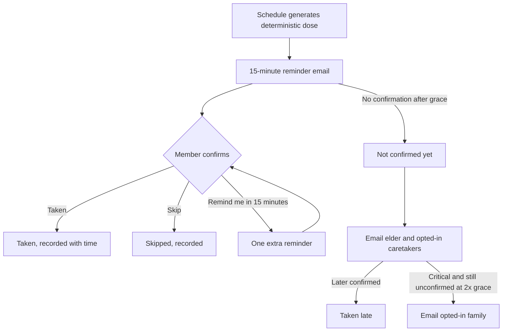

# Dhaaga

Dhaaga is an elderly-care and medication-management platform built around one shared Care Circle. An elder, caretakers, and family use a circle code and role passcodes; there are no member accounts. The elder remains in control of contacts, approval settings, and passcode rotation.


## What makes Dhaaga different

Dhaaga closes the loop between a scheduled dose and an acknowledged result. A reminder can be confirmed as taken, skipped, or snoozed; unconfirmed doses escalate to the elder and opted-in caretakers, and critical misses can later reach family. Caretaker medication changes can wait for elder approval. Prescription-photo reading creates an editable draft only; nothing is saved until a person checks and confirms it.

## Project description for submission (120 words)

Dhaaga is a care-circle platform for older adults, family members, and caretakers. It brings medication schedules, dose confirmations, and doctor appointments into an accessible space without requiring member accounts. The elder creates the circle with a PIN and controls trusted contacts, passcode rotation, and whether caretaker medicine changes need approval. Caretakers can manage schedules and appointments, while family members have a read-only view. Dose reminders support one-tap taken, skipped, or snoozed actions, then escalate unconfirmed events according to the elder’s circle settings and medicine criticality. Prescription photos can produce AI drafts, but a person must review it before saving. Dhaaga never provides medical advice or invents treatment instructions; it helps care teams stay coordinated while keeping decisions with the elder.

## Features by role

| Elder | Caretaker | Family |
|---|---|---|
| View and manage all circle data; record doses; choose approval mode; manage contacts and passcodes; review changes; use Elder Mode | View the circle; record doses; manage medicines and appointments; see activity; request elder approval when enabled | Read-only circle view, timeline, appointments, and adherence |

## Closed-loop dose flow



Non-critical missed doses are never individually emailed to family. Critical medicines use half the circle grace period, with a 10-minute minimum. Every email action opens a confirmation page; a GET request from an email scanner does not update a dose.

## Architecture and integrations

Next.js 15 App Router serves the mobile-first UI and API routes. The app can run as a standard Node.js service on Vercel or Render; the multi-stage Dockerfile is for Render or other Node hosts. Firestore stores a circle and its bounded subcollection records. Pure scheduling, dose transitions, permissions, token validation, notification policy, and adherence calculations live under `src/lib` and have Vitest coverage.

| Service | Use |
|---|---|
| Vercel or Render | Hosts Next.js; `vercel.json` and `render.yaml` configure deployment and scheduled ticks |
| Google Cloud Firestore | Stores circles, schedules, dose events, appointments, approvals, audit, auth attempts, and notification claims |
| Gemini API | Reads a prescription photo into a structured draft; the human reviews before saving |
| Gmail SMTP | Sends reminders when configured; without SMTP Dhaaga runs in DRY_RUN mode |

## Security, accessibility, and medical safety

- Passcodes are scrypt-hashed. Sessions are signed and stored in Secure, HttpOnly, SameSite=Lax cookies; changing passcodes invalidates older sessions.
- State-changing browser requests require a same-origin `Origin`. The cron endpoint uses a timing-safe secret comparison. Passcode guessing locks out after five failures for 15 minutes per circle and IP.
- API permissions are centralized. Firestore uses Application Default Credentials where supported. Vercel/Render can provide service-account JSON as an encrypted environment secret, parsed in memory; no key file belongs in this repository.
- Headers include CSP, `X-Content-Type-Options`, `Referrer-Policy`, and frame denial. Do not put credentials in source control or logs.
- The UI uses semantic landmarks, a skip link, labelled controls, visible keyboard focus, 18px base text, and 48px controls (64px in Elder Mode); reduced-motion preferences are respected.
- Dhaaga is not a medical device and does not recommend doses, interactions, diagnoses, or treatment. AI output is always an untrusted draft for human review.

## Local development

1. Use Node.js 22 or later and run `npm ci`.
2. Copy `.env.example` to `.env.local`; set `FIRESTORE_PROJECT_ID`, and generate `SESSION_SECRET`, `CRON_SECRET`, and `EMAIL_ACTION_SECRET` with at least 32 characters each.
3. Configure Application Default Credentials with access to Firestore, or set `FIRESTORE_SERVICE_ACCOUNT_JSON` to a service-account JSON secret in your local environment.
4. Run `npm run seed` to reset and seed the non-production `DEMO-0000` circle.
5. Run `npm run dev`. The landing page, setup, login, and demo are at `http://localhost:3000`.

`npm run seed` and `npm run reset-demo` replace only the `DEMO-0000` circle and its subcollections. Demo email delivery is disabled by the cron tick.
For a step-by-step demo setup and visitor instructions, see [DEMO.md](./DEMO.md).

## Environment variables and credentials

| Variable | Required value |
|---|---|
| `FIRESTORE_PROJECT_ID` | Google Cloud project ID containing the Firestore database |
| `FIRESTORE_SERVICE_ACCOUNT_JSON` | Optional service-account JSON for hosts without ADC; keep it only in encrypted environment settings, never in source control or a file |
| `SESSION_SECRET` | Random secret, at least 32 characters |
| `CRON_SECRET` | Random secret, at least 32 characters |
| `EMAIL_ACTION_SECRET` | Random secret, at least 32 characters |
| `GEMINI_API_KEY` | API key created for the Gemini API; photo reading is optional |
| `GEMINI_MODEL` | Model ID; default is `gemini-2.5-flash` |
| `GMAIL_USER` | Gmail address used as the SMTP sender |
| `GMAIL_APP_PASSWORD` | Gmail App Password (requires Google 2-Step Verification); leave unset for DRY_RUN |
| `APP_BASE_URL` | Public Vercel/Render service URL, or `http://localhost:3000` locally |

Do not send real secrets in chat or commit them. Create the Gemini key in Google AI Studio. Create the Gmail App Password in your Google Account after enabling 2-Step Verification. A service account used by Vercel or Render needs Firestore access in the Google Cloud project. Hosting outside Google Cloud removes Cloud Run and Cloud Scheduler setup, but Firestore itself still requires a Google Cloud project and credentials. If you do not want any Google Cloud project, the database must be changed from Firestore.

## Tests and checks

```bash
npm run lint
npm run typecheck
npm test
npm run build
npm audit --audit-level=high
```

The unit tests cover passcode hashing, session verification, permission rules, lockout, schedule generation, dose transitions, adherence calculations, notification windows and escalation, signed email actions, approval decision logic, and Gemini output validation with a mocked generator.

## Deployment

### Vercel

1. Import the GitHub repository into Vercel and select the Next.js framework preset.
2. Add the environment variables from `.env.example` in Project Settings. Generate the three signing secrets locally with `openssl rand -hex 32`; paste them directly into Vercel's encrypted environment-variable form. Add Firestore credentials only if the runtime does not have ADC.
3. Set `APP_BASE_URL` to the production deployment URL, then deploy. `vercel.json` schedules `/api/cron/tick` every minute; the handler validates Vercel's `Authorization: Bearer <CRON_SECRET>` header. Vercel Cron frequency depends on the plan; if one-minute jobs are unavailable, use Render Cron or the documented external fallback.
4. Verify the deployment URL's `/api/health`.

### Render

1. Create a Blueprint from this repository and use `render.yaml`, or create a Node web service (`npm ci && npm run build`, `npm start`) plus a Cron Job (`node scripts/cron-tick.mjs`).
2. Add the `.env.example` values in Render's environment settings. Set the same `CRON_SECRET` and `APP_BASE_URL` on both the web service and cron job. The Blueprint shares these through the `dhaaga-cron` environment group.
3. For the Docker option, build from the included multi-stage Dockerfile; it uses standalone output and a non-root runtime user.
4. Verify `/api/health`. For a hosted external scheduler, POST to `/api/cron/tick` with `x-cron-secret` set to the same secret.

Both providers should run the tick once per minute for the specified notification windows. A live deployment URL has not yet been provisioned from this development environment.

## Known limitations and future work

- A Firestore database and a service identity with access to it must exist in a Google Cloud project, even when the app is hosted elsewhere.
- Reminder delivery depends on Gmail SMTP configuration; missing SMTP credentials intentionally keep the service in DRY_RUN mode.
- Photo reading depends on a valid Gemini API key and a clear image; the user must review every field.
- Next: add automated axe scans to CI, verify authenticated dashboard flows against a disposable Firestore project, and evaluate production SMTP and provider cron behavior end-to-end.
